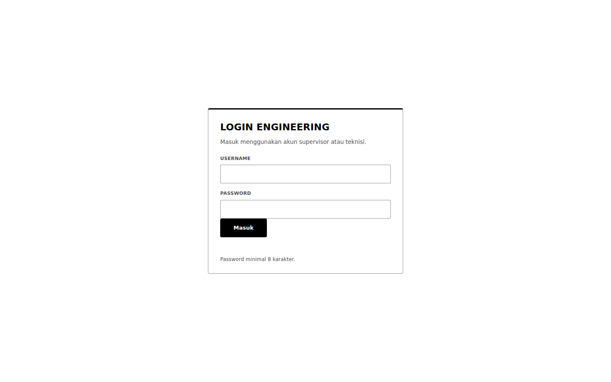
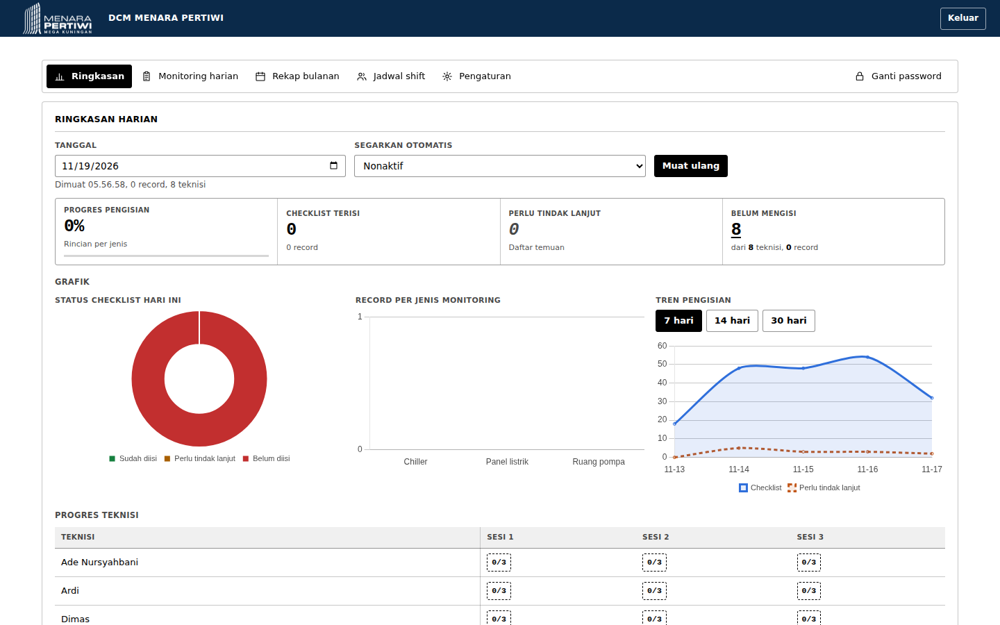
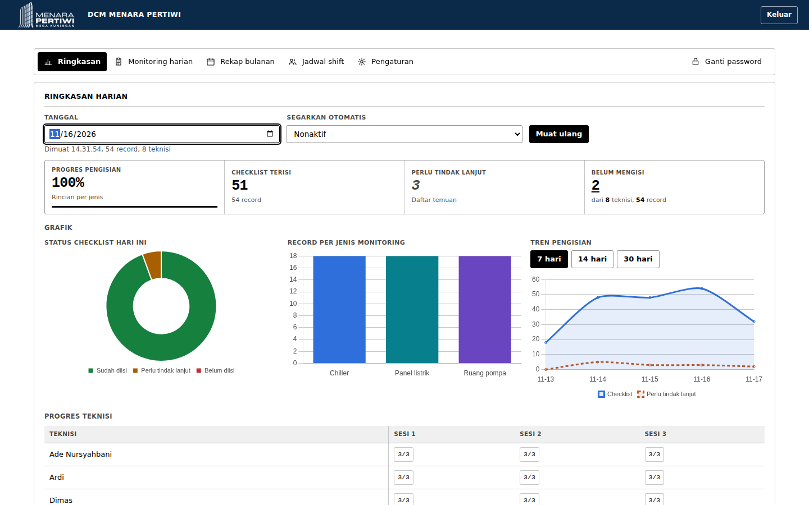
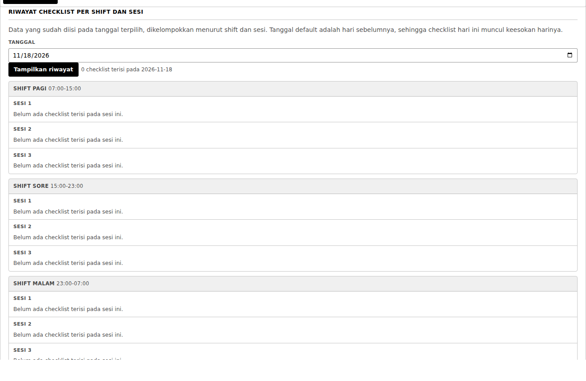
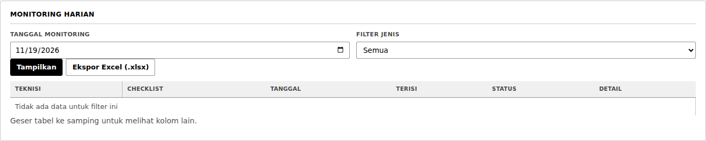
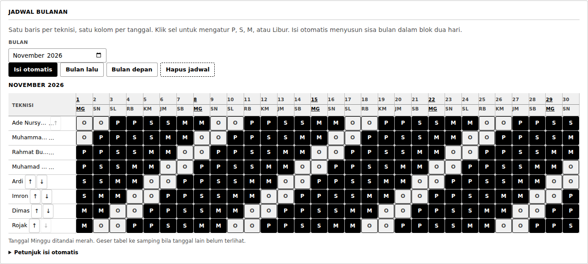
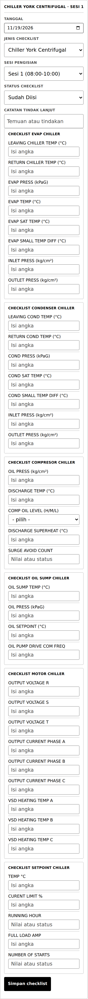
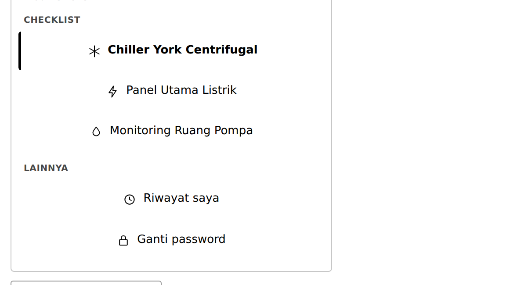
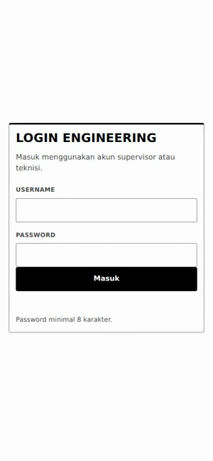

# DCM Menara Pertiwi

## Fitur

### Untuk teknisi

- Masuk dengan akun teknisi. Kolom password bisa ditampilkan atau disembunyikan, dan sesi login tetap tersimpan saat aplikasi Android dibuka kembali.
- Mengisi checklist harian untuk tiga jenis monitoring: Chiller York Centrifugal, Panel Utama Listrik, dan Monitoring Ruang Pompa.
- Setiap jenis checklist diisi dalam tiga sesi terpisah.
- Shift ditentukan otomatis dari jadwal tanggal terpilih, pembatasan akun, lalu shift yang sedang berjalan. Teknisi tidak perlu memilih shift secara manual.
- Item checklist menerima nilai teks, angka, dan pilihan status seperti A, O, M atau H, M, L.
- Menyimpan status **Sudah Diisi** atau **Perlu Tindak Lanjut**, lengkap dengan catatan tindak lanjut.
- Melihat detail checklist yang sudah diisi, memperbaruinya lewat tombol **Edit**, dan melengkapi checklist yang terlewat lewat tombol **Isi yang terlewat**.
- Melihat jadwal tugas dan hari libur sendiri.
- Mengunduh riwayat checklist sebagai Excel.
- Mengganti password sendiri.

### Untuk admin

- Masuk dengan akun admin dan mengganti password sendiri.
- Dashboard dengan pemilih tanggal, muat ulang manual, dan segarkan otomatis.
- Empat angka ringkasan yang bisa diklik: progres pengisian, checklist terisi, perlu tindak lanjut, dan belum mengisi.
- Grafik interaktif: donut status checklist, batang jumlah record per jenis monitoring, dan garis tren 7, 14, atau 30 hari. Klik pada grafik menyaring tabel monitoring.
- Matriks progres teknisi per sesi. Klik sel untuk melihat jenis monitoring yang belum diisi.
- Panel **Yang belum mengisi** yang menampilkan status tiap shift, teknisi yang dijadwalkan, dan rincian kekurangan per sesi serta jenis.
- Monitoring harian dengan filter jenis dan status, serta ekspor Excel.
- Rekap bulanan dengan filter jenis dan ekspor Excel.
- Riwayat checklist per shift dan sesi. Tanggal default adalah hari sebelumnya, sehingga checklist hari ini muncul keesokan harinya.
- Jadwal bulanan dengan kode **P** Pagi, **S** Sore, **M** Malam, **O** Libur, dan **-** belum dijadwalkan. Admin bisa mengatur jadwal per sel, menandai libur, mengurutkan teknisi, mengisi otomatis sisa bulan, dan menghapus jadwal.
- Mengatur jam mulai dan jam selesai tiap shift. Daftar shift tetap, hanya jamnya yang bisa diubah.
- Menambah dan menghapus pengguna serta mengatur peran dan pembatasan shift.
- Menambah, mengubah, dan menghapus item checklist tiap jenis monitoring.

### Aplikasi Android

- Membuka aplikasi yang sama dengan versi web, tanpa perlu memasang aplikasi lain.
- Menyimpan berkas Excel melalui pemilih berkas Android.
- Tetap masuk setelah aplikasi ditutup dan dibuka kembali selama token masih berlaku.
- Tombol kembali menutup dialog, kembali ke halaman sebelumnya, lalu keluar setelah ditekan dua kali.
- Layar muat saat membuka aplikasi dan layar khusus saat koneksi terputus.
- Tampilan menyesuaikan layar telepon dan area aman perangkat.

## Tampilan

### Masuk

### Dashboard admin

Dashboard dengan data checklist yang sudah terisi:

### Riwayat checklist per shift dan sesi

### Monitoring harian

### Jadwal shift

### Form checklist teknisi

### Riwayat checklist teknisi

## Video tutorial pengisian checklist

[Unduh versi video WebM](docs/videos/checklist-tutorial.webm)
